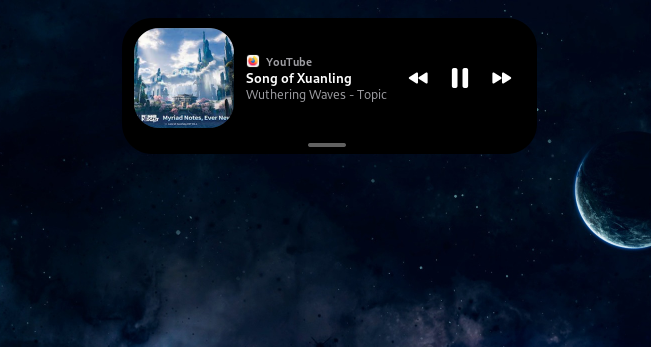
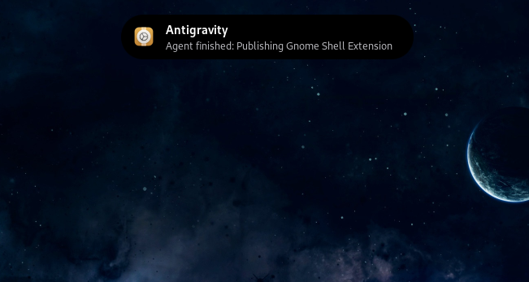
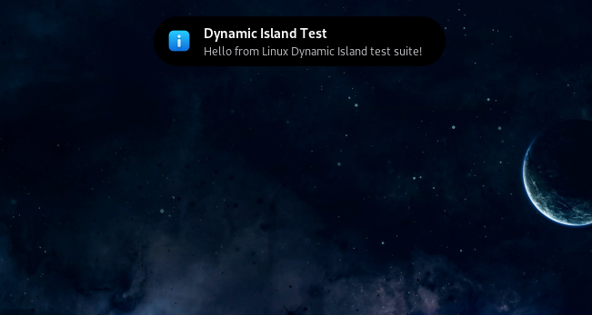
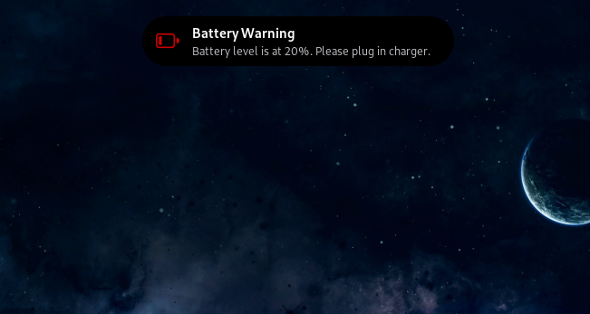
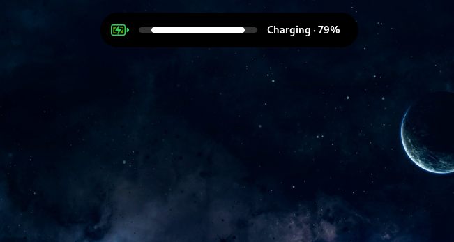

# Dynamic Island (Enhanced) for GNOME

<p align="center">
  
</p>

<p align="center">
  
</p>

<p align="center">
  
  
</p>

<p align="center">
  
  
</p>


Enhanced iOS-style live island for GNOME Shell featuring:
- **Auto-hide in fullscreen mode** (automatically hides during videos/games to prevent distractions)
- **iOS-style grab handle & swipe-to-tuck** (smooth gesture to tuck the island into the top notch)
- **Smooth animations & click-to-toggle details**
- Live playback status (Spotify, YouTube in browsers, any MPRIS player) with visualizer
- App notifications, Volume/Brightness OSD, charger, screen recording, Bluetooth devices, and download progress.
- Flexible positioning (top/bottom edges, or embedded in the panel around clock/status area).

*Forked and enhanced from the original [Dynamic Island by Bojan Jagetic](https://github.com/basskibo/linux_dynamic_island).*

Supports GNOME Shell 46–48.

## Install on another computer

```bash
gnome-extensions install --force dynamic-island@pheem49.shell-extension.zip
```

Log out and back in (required on Wayland), then:

```bash
gnome-extensions enable dynamic-island@pheem49
```

Settings: open the Extensions app → Dynamic Island → ⚙, or run `gnome-extensions prefs dynamic-island@pheem49`.

## Build the zip after changes

```bash
./pack.sh
```

## Testing

Run the feature test suite or simulate features directly on Dynamic Island:

```bash
# Interactive test menu
./run_tests.sh

# Run code quality & syntax unit tests
./run_tests.sh --test quality

# Test desktop & app notification toasts
./run_tests.sh --test notification

# Test volume OSD toast
./run_tests.sh --test volume

# Simulate music player (Spotify/Apple Music) with playback controls
./run_tests.sh --test music
```
